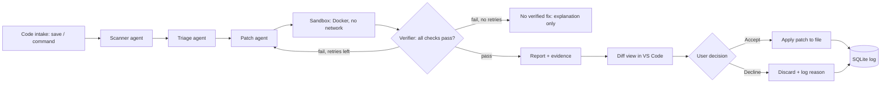

# Agentic Security Guard: Project Specification

> Purpose of this file: a complete context and specification document. Give it to an AI coding assistant (or use it as your HLD) so it can help design, build, and evaluate the project. It consolidates every decision made so far.

---

## 1. Project summary

**Course:** AI course, agentic AI project.

**Topic:** An automated security guard for software. It scans code for bugs and vulnerabilities, tests potential fixes in an isolated environment, and proposes a verified patch.

**Final scope decision:** A **VS Code extension** that runs **after the developer has written code**. It checks for a defined set of common security pain points, generates a patch, verifies it in a sandbox, and shows it to the user, who **accepts or declines** (Human-in-the-Loop, HITL). Nothing more.

**One-line pitch:** *Nothing reaches the user unless it passed objective checks, and nothing changes the code unless the user approves.*

---

## 2. Problem statement

Developers ship vulnerable code because:
- Security review is slow and often skipped.
- Static scanners are noisy (many false positives), so developers ignore them.
- Suggested fixes (from tools or LLMs) are rarely proven safe, and auto-patches risk breaking working code.
- Fixes often lack regression tests, so the same bug can return.
- Reviewing security PRs causes fatigue.

**Gap this project closes:** find the issue, write a fix, run the fix in isolation, and only propose a patch that has passed objective, automated checks.

---

## 3. Scope

### 3.1 In scope (MVP)
- Language: **Python only**.
- Delivery: **VS Code extension** plus a **local Python backend**.
- Trigger: on file save, or via command palette ("Security Guard: Scan File" / "Scan Workspace").
- Detection of these pain points:
  1. Hardcoded secrets and API keys
  2. SQL injection
  3. Command injection
  4. Path traversal
  5. Unsafe deserialization (for example `pickle.loads`, unsafe `yaml.load`)
  6. Vulnerable dependencies (CVEs in `requirements.txt`)
- Automatic patch generation (minimal diff).
- Sandbox verification (Docker, isolated, no network).
- HITL: diff view with Accept / Decline buttons.
- Logging of decisions for evaluation.

### 3.2 Out of scope (explicitly)
- Real-time, as-you-type scanning (documented as future work, see section 15).
- Languages other than Python.
- Auto-merging without human approval.
- Cloud deployment, multi-user support, authentication.
- CI/CD integration (optional stretch only).

---

## 4. End-to-end user flow

1. Developer writes code and saves a file (or runs the scan command).
2. Extension sends the file (and project context) to the local backend.
3. **Scanner agent** runs static tools plus an LLM review for logic-level issues.
4. **Triage agent** deduplicates, ranks by severity and exploitability, and drops likely false positives.
5. Remaining findings appear as **squiggles** in the editor and entries in the **Problems panel**.
6. For each finding (user-selected or all), the **Patch agent** generates a minimal diff.
7. The **Sandbox + Verifier** applies the patch in a Docker container and runs checks (section 8).
8. If verification fails, structured feedback goes back to the Patch agent; **max 3 retries**. If still failing, the finding is marked "no verified fix available" and the user gets the explanation only.
9. If verification passes, the extension opens VS Code's **built-in diff view** (original vs. patched) with an **evidence summary**: what was wrong, why it matters, what changed, which checks passed.
10. User clicks **Accept** (patch applied to the file) or **Decline** (discarded, optional reason).
11. Decision, reason, and metadata are logged to SQLite.

---

## 5. High-level architecture

```
┌──────────────────────── VS Code Extension (TypeScript) ────────────────────────┐
│ Commands, save listener, Diagnostics (squiggles), CodeActions, diff view,      │
│ Accept / Decline UI, status bar                                                │
└───────────────────────────────┬────────────────────────────────────────────────┘
                                │ HTTP (localhost) / JSON
┌───────────────────────────────▼────────────────────────────────────────────────┐
│ Backend (Python, FastAPI)                                                      │
│                                                                                │
│  Orchestrator (LangGraph state machine) + Shared State                         │
│                                                                                │
│  Code intake ─► Scanner agent ─► Triage agent ─► Patch agent ─► Sandbox ─►     │
│                                                    ▲             Verifier      │
│                                                    └── fail: retry (max 3) ◄─┘ │
│                                                                    │ pass      │
│                                                                    ▼           │
│                                                         Report + evidence      │
│                                                                                │
│  Tools: Semgrep, Bandit, gitleaks, pip-audit, pytest, Docker SDK, Claude API   │
│  Storage: SQLite (runs, findings, patches, decisions)                          │
└────────────────────────────────────────────────────────────────────────────────┘
```

### Diagram (Mermaid)



---

## 6. Components and responsibilities

| Component | Responsibility | Tech |
|---|---|---|
| VS Code extension | Triggers, diagnostics, diff view, Accept/Decline, status | TypeScript, VS Code Extension API (`DiagnosticCollection`, `CodeActionProvider`, `vscode.diff`, `TextDocumentContentProvider`) |
| Backend API | Receives scan requests, runs the agent graph, returns findings/patches | Python, FastAPI, Uvicorn |
| Orchestrator | State machine controlling agent order, retries, loop limits, shared state | LangGraph (or plain Python state machine) |
| Scanner agent | Runs static tools, runs LLM review for logic-level issues, normalizes output | Semgrep, Bandit, gitleaks, pip-audit, Claude API |
| Triage agent | Dedupe, severity and exploitability scoring, false-positive filtering | Claude API plus rules |
| Patch agent | Generates minimal diff plus explanation, uses verifier feedback on retries | Claude API |
| Sandbox | Throwaway isolated container to apply the patch and run checks | Docker SDK for Python |
| Verifier | Deterministic pass/fail gate based on evidence (not LLM opinion) | Python, pytest, scanners |
| Report generator | Builds evidence summary and unified diff | Python |
| Storage | Runs, findings, patches, decisions | SQLite |

---

## 7. Agent specifications

### 7.1 Scanner agent
- **Input:** file path(s), file contents, project root, dependency files.
- **Actions:**
  - Run Semgrep (security rule packs), Bandit, gitleaks, pip-audit.
  - Run an LLM review limited to the 6 target vulnerability classes to catch logic-level issues the tools miss.
  - Normalize everything into the common `Finding` schema (section 11).
- **Output:** list of raw findings.

### 7.2 Triage agent
- **Input:** raw findings plus surrounding code context.
- **Actions:** deduplicate (same file, line range, class), assign severity (low/medium/high/critical) and exploitability, mark likely false positives with a reason (for example, "input is a constant", "value is sanitized upstream").
- **Output:** ranked findings with `status = confirmed | dismissed` and a short rationale.

### 7.3 Patch agent
- **Input:** one confirmed finding, code context, and (on retries) structured verifier feedback.
- **Rules for the prompt:**
  - Produce the **smallest possible diff**; do not refactor unrelated code.
  - Preserve behavior and public interfaces.
  - Also produce a **regression/exploit test** that fails on the original code and passes on the patched code.
  - Provide a plain-language explanation: what was wrong, why it matters, what changed.
  - Output a **unified diff** only (plus test file and explanation) in a strict JSON structure.
- **Output:** `Patch` object (section 11).

### 7.4 Sandbox runner
- Copies the project into a fresh container, applies the patch and the new test, runs the checks, returns structured results, destroys the container.

### 7.5 Verifier
- Pure code, no LLM judgment. Evaluates the checklist in section 8 and returns `pass` or `fail` with machine-readable reasons used as retry feedback.

---

## 8. Definition of a "verified" patch

A patch is **verified** only if **all** hold:

1. **Patch applies cleanly** to the original file (no conflicts).
2. **Existing test suite passes** (if the project has tests; if none exist, record "no baseline tests" in the evidence).
3. **Regression/exploit test** fails on the original code and passes on the patched code.
4. **Scanner re-run:** the original finding is no longer reported.
5. **No new findings** introduced by the patch.
6. **Diff is in scope:** touches only relevant files, small size (configurable limit, for example under 40 changed lines per finding).
7. **Syntax/lint check** passes (`python -m py_compile`, optional ruff).

Failure at any step returns a structured reason to the Patch agent, for example `{"check": "regression_test", "result": "still_fails", "log": "..."}`. After 3 failed attempts, stop and escalate (explanation only, no patch offered).

---

## 9. Sandbox specification

- Docker container built from a pinned slim Python image.
- **No network** (`network_mode="none"`).
- Resource limits: CPU (for example 1 core), memory (for example 512 MB), PIDs limit, execution timeout (for example 60 s).
- Read-only base image; project copied into a writable temp volume, deleted afterward.
- Run as a non-root user; drop capabilities.
- Dependencies for the target project must be pre-installed into a cached image layer (since there is no network at run time). For the MVP, use a prepared image per demo project.
- Never execute the patch or tests on the host machine.
- Optional optimization: pre-warmed container pool.

---

## 10. Vulnerability classes: detection, patch strategy, verification

| Class | Detection | Typical patch | Verification test idea |
|---|---|---|---|
| Hardcoded secrets | gitleaks, Semgrep, regex plus entropy | Replace literal with `os.environ["NAME"]`; add entry to `.env.example` | Scanner no longer flags; test asserts the app reads from env |
| SQL injection | Semgrep, Bandit (B608), LLM | Parameterized queries (`cursor.execute(sql, params)`) | Exploit test passes payload like `' OR '1'='1` and must not return extra rows |
| Command injection | Bandit (B602/B605), Semgrep | Use `subprocess.run([...], shell=False)` with argument list; validate input | Test passes `; echo pwned` and must not execute it |
| Path traversal | Semgrep, LLM | Resolve path, ensure it stays under a base directory (`Path.resolve()` plus `is_relative_to`) | Test passes `../../etc/passwd` and must raise/deny |
| Unsafe deserialization | Bandit (B301/B506), Semgrep | `yaml.safe_load`, replace `pickle` with JSON | Test passes a malicious payload and must not execute it |
| Vulnerable dependency | pip-audit | Bump to the fixed version in `requirements.txt` | Install in sandbox (pre-fetched wheels), run tests, pip-audit clean |

---

## 11. Data contracts (schemas)

### 11.1 Finding
```json
{
  "id": "f_001",
  "file": "app/db.py",
  "line_start": 42,
  "line_end": 44,
  "class": "sql_injection",
  "severity": "high",
  "source_tool": "semgrep",
  "message": "User input concatenated into SQL query",
  "code_snippet": "cursor.execute(\"SELECT * FROM users WHERE id=\" + uid)",
  "status": "confirmed",
  "triage_rationale": "uid comes from request.args without validation"
}
```

### 11.2 Patch
```json
{
  "finding_id": "f_001",
  "attempt": 1,
  "unified_diff": "--- a/app/db.py\n+++ b/app/db.py\n@@ ...",
  "regression_test": {"path": "tests/test_sec_f_001.py", "content": "..."},
  "explanation": {
    "what_was_wrong": "...",
    "why_it_matters": "...",
    "what_changed": "..."
  }
}
```

### 11.3 Verification result
```json
{
  "finding_id": "f_001",
  "attempt": 1,
  "verified": true,
  "checks": {
    "patch_applies": "pass",
    "existing_tests": "pass",
    "regression_test_before": "fail_as_expected",
    "regression_test_after": "pass",
    "rescan_clean": "pass",
    "no_new_findings": "pass",
    "diff_in_scope": "pass",
    "syntax_ok": "pass"
  },
  "logs": "..."
}
```

### 11.4 User decision
```json
{
  "finding_id": "f_001",
  "decision": "accepted",
  "reason": null,
  "timestamp": "2026-10-31T12:00:00Z"
}
```

---

## 12. API contract (backend, localhost)

| Method | Endpoint | Purpose |
|---|---|---|
| `POST` | `/scan` | Body: file path(s) and contents. Returns `run_id` and list of triaged `Finding`s |
| `POST` | `/patch` | Body: `run_id`, `finding_id`. Runs patch plus sandbox verification loop. Returns `Patch` plus `VerificationResult` (or "no verified fix") |
| `POST` | `/decision` | Body: `finding_id`, `decision` (`accepted`/`declined`), optional `reason` |
| `GET` | `/runs/{run_id}` | Run details and history |
| `GET` | `/health` | Backend, Docker, and tools availability check |

For long-running `/patch` calls, use a job id with polling (`GET /jobs/{id}`) or Server-Sent Events so the extension can show progress ("Generating patch… Running sandbox… Verifying…").

---

## 13. VS Code extension specification

- **Activation:** on Python files and on command.
- **Commands:**
  - `securityGuard.scanFile`
  - `securityGuard.scanWorkspace`
  - `securityGuard.generatePatch` (for a selected finding)
  - `securityGuard.accept` / `securityGuard.decline`
- **UI elements:**
  - Diagnostics (squiggles and Problems panel entries) with severity.
  - Quick Fix (lightbulb) action: "Generate verified patch".
  - Diff editor via `vscode.diff` using a virtual document provider for the patched version.
  - Webview or notification panel with the evidence summary and **Accept / Decline** buttons.
  - Status bar item showing scan state.
- **Accept:** apply the patch with `WorkspaceEdit`, then send `/decision`.
- **Decline:** prompt for an optional reason, then send `/decision`.
- **Settings:** backend URL, scan on save (on/off), LLM model, max retries, severity threshold.

---

## 14. Technology stack

- **Extension:** TypeScript, VS Code Extension API, `yo code` generator.
- **Backend:** Python 3.11+, FastAPI, Uvicorn, Pydantic.
- **Agent framework:** LangGraph (or custom state machine).
- **LLM:** Claude API via the Anthropic SDK (tool use, structured JSON output).
- **Scanners:** Semgrep, Bandit, gitleaks, pip-audit.
- **Sandbox:** Docker, Docker SDK for Python.
- **Testing in sandbox:** pytest.
- **Storage:** SQLite (SQLAlchemy or plain `sqlite3`).

### Suggested folder structure

```
security-guard/
├── extension/                  # VS Code extension (TypeScript)
│   ├── src/
│   │   ├── extension.ts
│   │   ├── diagnostics.ts
│   │   ├── diffProvider.ts
│   │   ├── backendClient.ts
│   │   └── ui/
│   ├── package.json
│   └── tsconfig.json
├── backend/
│   ├── app/
│   │   ├── main.py             # FastAPI entry
│   │   ├── api/                # routes: scan, patch, decision
│   │   ├── graph/              # LangGraph definition, state, edges
│   │   ├── agents/
│   │   │   ├── scanner.py
│   │   │   ├── triage.py
│   │   │   └── patcher.py
│   │   ├── tools/              # semgrep.py, bandit.py, gitleaks.py, pip_audit.py
│   │   ├── sandbox/            # runner.py, Dockerfile, policies
│   │   ├── verifier/           # checks.py
│   │   ├── models/             # Pydantic schemas
│   │   ├── db/                 # SQLite models
│   │   └── prompts/            # prompt templates
│   ├── tests/
│   └── requirements.txt
├── demo_apps/                  # intentionally vulnerable Python apps
├── evaluation/                 # datasets, scripts, results
└── README.md
```

---

## 15. Future work: real-time version (not in MVP)

Documented so the architecture stays extensible. To make it real time later, split into two paths:

- **Fast path (under 1-2 s, while typing or on save):** file watcher or LSP server sends only the changed file or function. Run incremental static scanners (Semgrep, Bandit, gitleaks) on the diff only. Show inline warnings immediately. No LLM or sandbox.
- **Slow path (seconds to a minute, background):** debounce triggers (2-3 s after the last keystroke); LLM triages and patches only confirmed findings; sandbox uses a pre-warmed container pool and runs only impacted tests; surface a "Verified fix available" quick fix.
- **Required architecture changes:**
  1. Event layer (file watcher or LSP server) before intake.
  2. Cache keyed by file hash so unchanged code is not rescanned.
  3. Job queue with cancellation so new edits kill stale scans/patches.
  4. Warm sandbox pool plus test selection.
  5. Verifier remains the gate: never show an unverified patch as a fix, only as a warning.
- **Recommended approach:** build the after-coding version first; add real time as an extension that calls the same backend.

---

## 16. Evaluation plan

### 16.1 Test data
- Intentionally vulnerable apps: DVWA-style apps, OWASP Juice Shop (for reference), pygoat.
- Your own `demo_apps/` with seeded vulnerabilities (at least 2-3 per class).
- Optional datasets: CVEfixes, OWASP Benchmark.

### 16.2 Metrics
- **Detection rate** (recall on seeded vulnerabilities).
- **False-positive rate** before vs. after triage.
- **Patch success rate** (verified patches / confirmed findings).
- **Average retries** per fix.
- **Regression rate** (patches that broke existing tests; should be 0 for verified patches).
- **Acceptance rate** (HITL accepted / patches shown).
- **Time per finding** (scan, patch, verify).

### 16.3 Baselines and ablations (makes the project defensible)
1. Scanner only (no patch).
2. LLM patch with **no** sandbox verification.
3. Full system (patch plus sandbox verification plus retries).
4. Full system without triage (shows the false-positive benefit).

---

## 17. Safety and risk considerations

| Risk | Mitigation |
|---|---|
| Running untrusted/patched code | Docker sandbox: no network, resource limits, non-root, timeouts |
| LLM hallucinated or harmful patch | Verifier gate with objective checks; max 3 retries; HITL approval |
| Patch breaks behavior | Existing tests plus regression test plus small-diff rule |
| Code or secrets sent to the LLM API | Warn the user; redact detected secrets before sending; allow a local-only mode (tools only) |
| Prompt injection from code comments | Treat code as data; strict JSON output schema; verifier does not trust LLM claims |
| False positives annoy users | Triage agent; severity threshold setting |
| Scope creep | Python only, 6 vulnerability classes, no real-time in MVP |

---

## 18. Roadmap (about 5 weeks)

| Week | Deliverables |
|---|---|
| 1 | Extension skeleton, backend skeleton, `/scan` endpoint, scanner agent (tools), seeded demo app, diagnostics in editor |
| 2 | Docker sandbox runner, test execution, sandbox security policy |
| 3 | Patch agent, verifier loop with retries, diff view plus Accept/Decline (core of the project) |
| 4 | Triage agent, evidence report, decision logging, polish UI |
| 5 | Evaluation, baselines and ablations, write-up, demo video |

---

## 19. Instructions for the AI assistant using this document

When helping with this project:
1. Treat sections 3 and 4 as the **authoritative scope**; do not add features outside them (no real-time, no other languages, no auto-merge).
2. The **verifier is deterministic code**, never an LLM judgment (section 8).
3. All agent outputs must be **strict JSON** matching section 11.
4. Prefer **small, testable modules**; each agent should be runnable on its own with fixture inputs.
5. Never execute patched or untrusted code outside the Docker sandbox.
6. Ask before changing the architecture; keep the real-time path (section 15) as a future extension.
7. Suggested first tasks: (a) scaffold the repo per section 14, (b) implement the Pydantic schemas from section 11, (c) build the `/scan` endpoint with Semgrep and Bandit, (d) create one seeded vulnerable demo app.

---

## 20. Glossary

- **HITL:** Human-in-the-Loop; a human approves or rejects the final action.
- **Agent:** an LLM-driven component with a defined role, inputs, outputs, and tools.
- **Orchestrator:** the state machine that sequences agents and handles retries.
- **Verified patch:** a patch that passed every check in section 8.
- **Triage:** filtering and ranking findings to reduce noise.
- **LSP:** Language Server Protocol, used by editors for real-time language features.
